# Use Case Diagram — Smart Hospital AI
### Based on complete analysis of all 10 controllers & routes

---

## Full System Use Case Diagram

```mermaid
flowchart TD

    %% ════════════════════════════════════════
    %%  ACTORS
    %% ════════════════════════════════════════
    PATIENT(["🧑 Patient"])
    DOCTOR(["👨‍⚕️ Doctor"])
    ADMIN(["👤 Admin"])
    SYSTEM(["⚙️ System\n(Background)"])
    OPENAI(["🤖 OpenAI API"])
    DEEPGRAM(["🎙️ Deepgram"])
    RAZORPAY(["💳 Razorpay"])
    FCM(["🔔 Firebase FCM"])

    %% ════════════════════════════════════════
    %%  SYSTEM BOUNDARY
    %% ════════════════════════════════════════
    subgraph SH ["⬜ Smart Hospital AI — System Boundary"]

        %% ── AUTH ────────────────────────────
        subgraph AUTH ["🔐 Authentication"]
            UC_REG["UC01\nRegister Account\n(Patient only — public)"]
            UC_LOGIN["UC02\nLogin"]
            UC_ME["UC03\nGet Own Profile\n(GET /api/auth/me)"]
        end

        %% ── APPOINTMENTS ────────────────────
        subgraph APPT ["📅 Appointment Management"]
            UC_BOOK["UC04\nBook Appointment"]
            UC_VIEW_APPT["UC05\nView Appointments\n(role-filtered)"]
            UC_STATUS["UC06\nUpdate Appointment Status\n(confirm / complete / cancel)"]
            UC_CANCEL["UC07\nCancel Appointment"]
        end

        %% ── MEDICAL RECORDS ─────────────────
        subgraph RECORDS ["📋 Medical Records"]
            UC_UPLOAD["UC08\nUpload Medical Record\n(file + metadata)"]
            UC_MY_REC["UC09\nView My Records\n(Patient)"]
            UC_PAT_REC["UC10\nView Patient Records\n(by patientId)"]
            UC_DEL_REC["UC11\nDelete Record"]
        end

        %% ── TREATMENT COURSES ───────────────
        subgraph TREAT ["💊 Treatment Courses"]
            UC_CREATE_TC["UC12\nCreate Treatment Course\n(medicines, diagnosis, diet, lifestyle)"]
            UC_MY_TC["UC13\nView My Treatment Courses\n(Patient)"]
            UC_ACTIVE_TC["UC14\nView Active Courses\n(Patient — used by AI)"]
            UC_PAT_TC["UC15\nView Patient Courses\n(Doctor / Admin)"]
            UC_STATUS_TC["UC16\nUpdate Course Status\n(active / completed / cancelled)"]
        end

        %% ── BILLING & PAYMENT ───────────────
        subgraph BILLING ["💳 Billing & Payments"]
            UC_CREATE_BILL["UC17\nGenerate Bill\n(Doctor / Admin)"]
            UC_MY_BILLS["UC18\nView My Bills\n(Patient)"]
            UC_PAY["UC19\nInitiate Payment\n(Create Razorpay Order)"]
            UC_VERIFY["UC20\nVerify Payment\n& Mark Bill Paid"]
        end

        %% ── AI ASSISTANT ────────────────────
        subgraph AI_MOD ["🤖 AI Assistant"]
            UC_CHAT["UC21\nChat with AI\n(POST /api/ai/chat)"]
            UC_INTENT["UC22\nDetect Intent\n(keyword engine)"]
            UC_CONTEXT["UC23\nBuild Patient Context\n(active treatments)"]
            UC_VOICE["UC24\nVoice Interaction\n(Deepgram transcription)"]
            UC_REDIRECT["UC25\nAI-Triggered Redirect\n(to feature page)"]
        end

        %% ── DOCTORS ─────────────────────────
        subgraph DOCS ["👨‍⚕️ Doctor Management"]
            UC_LIST_DOC["UC26\nList / Search Doctors\n(by specialization)"]
            UC_GET_DOC["UC27\nGet Doctor Profile"]
            UC_CREATE_DOC["UC28\nCreate Doctor Profile\n(Admin only)"]
            UC_UPD_DOC["UC29\nUpdate Doctor Profile"]
            UC_DEL_DOC["UC30\nDelete Doctor\n(Admin only)"]
        end

        %% ── PATIENTS ────────────────────────
        subgraph PATS ["🧑 Patient Management"]
            UC_LIST_PAT["UC31\nList All Patients\n(Admin / Doctor)"]
            UC_MY_PROF["UC32\nView My Profile\n(Patient)"]
            UC_GET_PAT["UC33\nGet Patient by ID"]
            UC_UPD_PAT["UC34\nUpdate Patient Profile"]
            UC_DEL_PAT["UC35\nDelete Patient\n(Admin only)"]
        end

        %% ── ADMIN ───────────────────────────
        subgraph ADMIN_MOD ["🛡️ Admin Operations"]
            UC_APPROVE["UC36\nApprove Doctor Registration"]
            UC_PENDING["UC37\nView Pending Doctor Requests"]
            UC_CREATE_USR["UC38\nCreate Any User Account\n(admin / doctor / patient)"]
            UC_LIST_USR["UC39\nList / Filter All Users"]
        end

        %% ── NOTIFICATIONS ───────────────────
        subgraph NOTIF ["🔔 Notifications"]
            UC_GET_NOTIF["UC40\nView Notifications\n(+ unread count)"]
            UC_READ_ONE["UC41\nMark Notification as Read"]
            UC_READ_ALL["UC42\nMark All as Read"]
            UC_CREATE_NOTIF["UC43\nSend Manual Notification\n(Admin only)"]
            UC_REMINDER["UC44\nAuto Appointment Reminder\n(background polling)"]
        end

    end

    %% ════════════════════════════════════════
    %%  PATIENT ASSOCIATIONS
    %% ════════════════════════════════════════
    PATIENT --- UC_REG
    PATIENT --- UC_LOGIN
    PATIENT --- UC_ME
    PATIENT --- UC_BOOK
    PATIENT --- UC_VIEW_APPT
    PATIENT --- UC_CANCEL
    PATIENT --- UC_MY_REC
    PATIENT --- UC_MY_TC
    PATIENT --- UC_ACTIVE_TC
    PATIENT --- UC_MY_BILLS
    PATIENT --- UC_PAY
    PATIENT --- UC_VERIFY
    PATIENT --- UC_CHAT
    PATIENT --- UC_VOICE
    PATIENT --- UC_LIST_DOC
    PATIENT --- UC_GET_DOC
    PATIENT --- UC_MY_PROF
    PATIENT --- UC_GET_NOTIF
    PATIENT --- UC_READ_ONE
    PATIENT --- UC_READ_ALL

    %% ════════════════════════════════════════
    %%  DOCTOR ASSOCIATIONS
    %% ════════════════════════════════════════
    DOCTOR --- UC_LOGIN
    DOCTOR --- UC_ME
    DOCTOR --- UC_VIEW_APPT
    DOCTOR --- UC_STATUS
    DOCTOR --- UC_CANCEL
    DOCTOR --- UC_UPLOAD
    DOCTOR --- UC_PAT_REC
    DOCTOR --- UC_DEL_REC
    DOCTOR --- UC_CREATE_TC
    DOCTOR --- UC_PAT_TC
    DOCTOR --- UC_STATUS_TC
    DOCTOR --- UC_CREATE_BILL
    DOCTOR --- UC_LIST_PAT
    DOCTOR --- UC_GET_PAT
    DOCTOR --- UC_GET_DOC
    DOCTOR --- UC_UPD_DOC
    DOCTOR --- UC_CHAT
    DOCTOR --- UC_GET_NOTIF
    DOCTOR --- UC_READ_ONE
    DOCTOR --- UC_READ_ALL

    %% ════════════════════════════════════════
    %%  ADMIN ASSOCIATIONS
    %% ════════════════════════════════════════
    ADMIN --- UC_LOGIN
    ADMIN --- UC_ME
    ADMIN --- UC_APPROVE
    ADMIN --- UC_PENDING
    ADMIN --- UC_CREATE_USR
    ADMIN --- UC_LIST_USR
    ADMIN --- UC_VIEW_APPT
    ADMIN --- UC_STATUS
    ADMIN --- UC_LIST_PAT
    ADMIN --- UC_GET_PAT
    ADMIN --- UC_UPD_PAT
    ADMIN --- UC_DEL_PAT
    ADMIN --- UC_LIST_DOC
    ADMIN --- UC_CREATE_DOC
    ADMIN --- UC_UPD_DOC
    ADMIN --- UC_DEL_DOC
    ADMIN --- UC_CREATE_BILL
    ADMIN --- UC_PAT_TC
    ADMIN --- UC_STATUS_TC
    ADMIN --- UC_PAT_REC
    ADMIN --- UC_DEL_REC
    ADMIN --- UC_CREATE_NOTIF
    ADMIN --- UC_GET_NOTIF
    ADMIN --- UC_READ_ONE
    ADMIN --- UC_READ_ALL

    %% ════════════════════════════════════════
    %%  SYSTEM (BACKGROUND) ASSOCIATIONS
    %% ════════════════════════════════════════
    SYSTEM --- UC_REMINDER

    %% ════════════════════════════════════════
    %%  EXTERNAL SERVICE ASSOCIATIONS
    %% ════════════════════════════════════════
    UC_CHAT  --- OPENAI
    UC_VOICE --- DEEPGRAM
    UC_PAY   --- RAZORPAY
    UC_VERIFY --- RAZORPAY
    UC_REMINDER --- FCM
    UC_CREATE_NOTIF --- FCM

    %% ════════════════════════════════════════
    %%  INCLUDE / EXTEND RELATIONSHIPS
    %% ════════════════════════════════════════
    UC_CHAT -.->|include| UC_INTENT
    UC_CHAT -.->|include| UC_CONTEXT
    UC_CHAT -.->|extend| UC_REDIRECT
    UC_VOICE -.->|include| UC_CHAT
    UC_PAY -.->|include| UC_VERIFY
    UC_REMINDER -.->|include| UC_CREATE_NOTIF
    UC_BOOK -.->|extend| UC_CREATE_NOTIF
    UC_STATUS -.->|extend| UC_CREATE_NOTIF
    UC_CREATE_TC -.->|extend| UC_CREATE_NOTIF
    UC_CREATE_BILL -.->|extend| UC_CREATE_NOTIF
```

---

## Actor — Use Case Matrix

| Use Case | Patient | Doctor | Admin | System |
|---|:---:|:---:|:---:|:---:|
| UC01 Register Account | ✅ | — | — | — |
| UC02 Login | ✅ | ✅ | ✅ | — |
| UC03 Get Own Profile | ✅ | ✅ | ✅ | — |
| UC04 Book Appointment | ✅ | — | — | — |
| UC05 View Appointments | ✅ | ✅ | ✅ | — |
| UC06 Update Appointment Status | — | ✅ | ✅ | — |
| UC07 Cancel Appointment | ✅ | ✅ | — | — |
| UC08 Upload Medical Record | — | ✅ | ✅ | — |
| UC09 View My Records | ✅ | — | — | — |
| UC10 View Patient Records | — | ✅ | ✅ | — |
| UC11 Delete Record | — | ✅ | ✅ | — |
| UC12 Create Treatment Course | — | ✅ | — | — |
| UC13 View My Treatment Courses | ✅ | — | — | — |
| UC14 View Active Courses | ✅ | — | — | — |
| UC15 View Patient Courses | — | ✅ | ✅ | — |
| UC16 Update Course Status | — | ✅ | ✅ | — |
| UC17 Generate Bill | — | ✅ | ✅ | — |
| UC18 View My Bills | ✅ | — | — | — |
| UC19 Initiate Payment (Razorpay) | ✅ | — | — | — |
| UC20 Verify Payment | ✅ | — | — | — |
| UC21 Chat with AI | ✅ | ✅ | — | — |
| UC22 Detect Intent (internal) | — | — | — | ✅ |
| UC23 Build Patient Context (internal) | — | — | — | ✅ |
| UC24 Voice Interaction (Deepgram) | ✅ | — | — | — |
| UC25 AI-Triggered Redirect | ✅ | ✅ | — | — |
| UC26 List / Search Doctors | ✅ | ✅ | ✅ | — |
| UC27 Get Doctor Profile | ✅ | ✅ | ✅ | — |
| UC28 Create Doctor Profile | — | — | ✅ | — |
| UC29 Update Doctor Profile | — | ✅ | ✅ | — |
| UC30 Delete Doctor | — | — | ✅ | — |
| UC31 List All Patients | — | ✅ | ✅ | — |
| UC32 View My Profile | ✅ | — | — | — |
| UC33 Get Patient by ID | — | ✅ | ✅ | — |
| UC34 Update Patient Profile | — | — | ✅ | — |
| UC35 Delete Patient | — | — | ✅ | — |
| UC36 Approve Doctor Registration | — | — | ✅ | — |
| UC37 View Pending Doctor Requests | — | — | ✅ | — |
| UC38 Create Any User Account | — | — | ✅ | — |
| UC39 List / Filter All Users | — | — | ✅ | — |
| UC40 View Notifications | ✅ | ✅ | ✅ | — |
| UC41 Mark Notification as Read | ✅ | ✅ | ✅ | — |
| UC42 Mark All Notifications as Read | ✅ | ✅ | ✅ | — |
| UC43 Send Manual Notification | — | — | ✅ | — |
| UC44 Auto Appointment Reminder | — | — | — | ✅ |

---

## Include / Extend Relationships

| Base Use Case | Type | Relationship |
|---|---|---|
| UC21 Chat with AI | `<<include>>` | UC22 Detect Intent |
| UC21 Chat with AI | `<<include>>` | UC23 Build Patient Context |
| UC21 Chat with AI | `<<extend>>` | UC25 AI-Triggered Redirect |
| UC24 Voice Interaction | `<<include>>` | UC21 Chat with AI |
| UC19 Initiate Payment | `<<include>>` | UC20 Verify Payment |
| UC44 Appointment Reminder | `<<include>>` | UC43 Create Notification (FCM) |
| UC04 Book Appointment | `<<extend>>` | UC43 Create Notification |
| UC06 Update Appointment Status | `<<extend>>` | UC43 Create Notification |
| UC12 Create Treatment Course | `<<extend>>` | UC43 Create Notification |
| UC17 Generate Bill | `<<extend>>` | UC43 Create Notification |

---

> [!NOTE]
> **Registration is blocked for `admin` and `doctor` roles** via the public API.  
> Doctors must be created by an Admin (UC38) or self-register and wait for Admin approval (UC36).  
> Admins can only be created directly through the Admin `createUser` endpoint (UC38).
