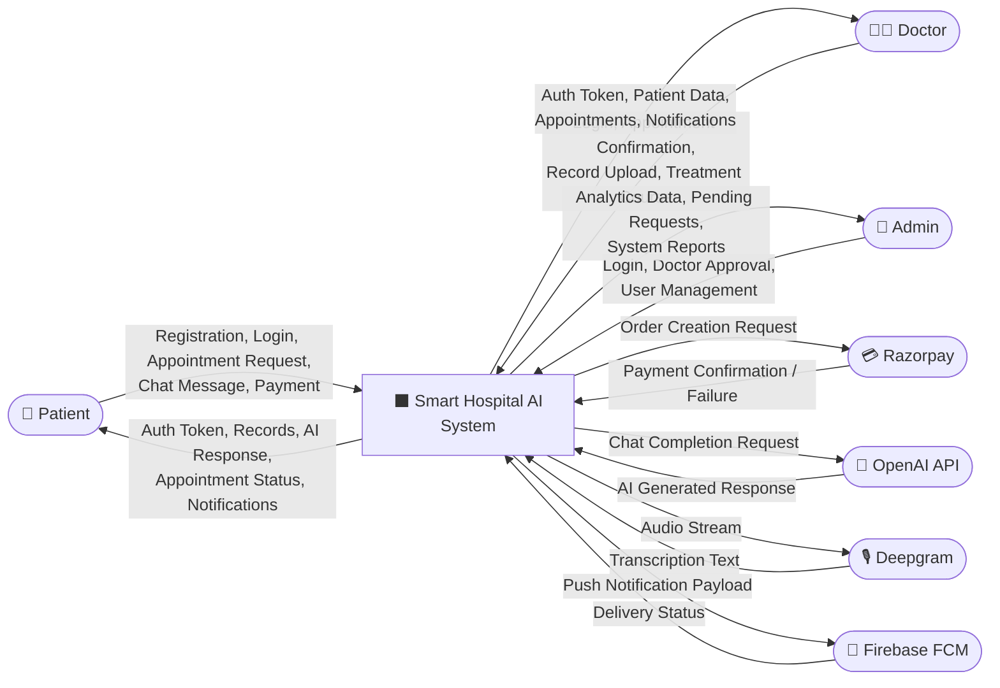
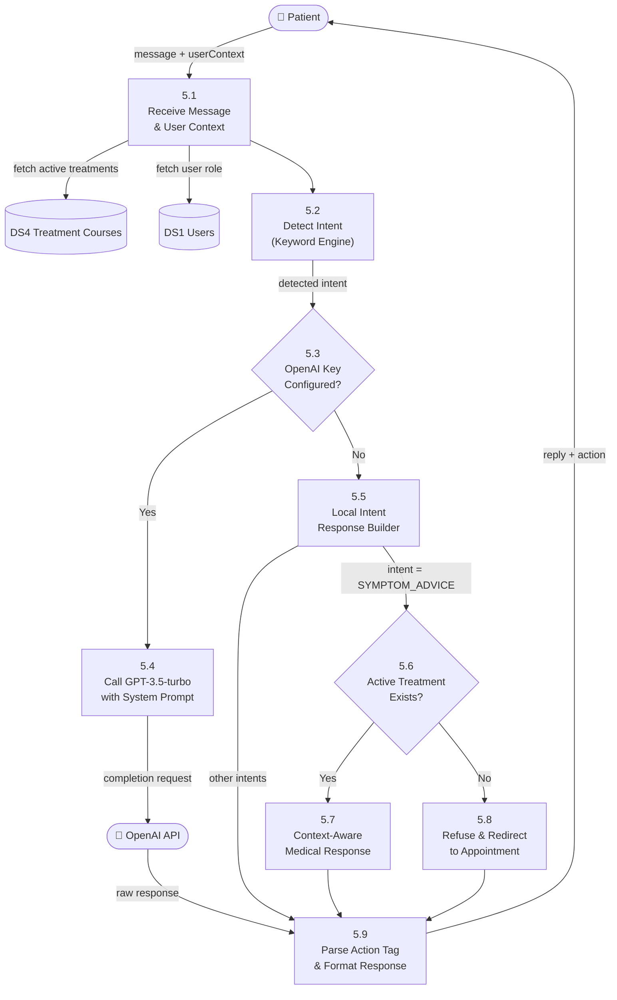

# Data Flow Diagram — Smart Hospital AI

## Level 0: Context Diagram (DFD)

> Shows the system as a single process and all external entities interacting with it.

---

## Level 1: Main System Processes

> Breaks the system into its major processing modules and shows data flows between them.

```mermaid
flowchart TD
    %% External Entities
    Patient(["🧑 Patient"])
    Doctor(["👨‍⚕️ Doctor"])
    Admin(["👤 Admin"])
    ExtAI(["🤖 OpenAI API"])
    ExtPay(["💳 Razorpay"])
    ExtPush(["🔔 FCM"])

    %% Processes
    P1["1.0\nAuthentication\n& Authorization"]
    P2["2.0\nAppointment\nManagement"]
    P3["3.0\nMedical Records\nManagement"]
    P4["4.0\nTreatment Course\nManagement"]
    P5["5.0\nAI Assistant\nProcessing"]
    P6["6.0\nBilling &\nPayment"]
    P7["7.0\nNotification\nEngine"]
    P8["8.0\nAdmin &\nAnalytics"]

    %% Data Stores
    DS1[("DS1\nUsers")]
    DS2[("DS2\nAppointments")]
    DS3[("DS3\nRecords")]
    DS4[("DS4\nTreatment\nCourses")]
    DS5[("DS5\nBills")]
    DS6[("DS6\nNotifications")]

    %% Auth flows
    Patient -- "credentials / register data" --> P1
    Doctor  -- "credentials / register data" --> P1
    Admin   -- "credentials"                 --> P1
    P1 -- "read/write user"   --> DS1
    P1 -- "JWT token"         --> Patient
    P1 -- "JWT token"         --> Doctor
    P1 -- "JWT token"         --> Admin

    %% Appointment flows
    Patient -- "appointment request"       --> P2
    Doctor  -- "confirm/cancel"            --> P2
    P2 -- "read available doctors"        --> DS1
    P2 -- "write appointment"             --> DS2
    P2 -- "read appointments"             --> DS2
    P2 -- "appointment data"              --> Patient
    P2 -- "appointment data"              --> Doctor
    P2 -- "trigger notification"          --> P7

    %% Records flows
    Doctor  -- "upload file + metadata"   --> P3
    Patient -- "view request"             --> P3
    P3 -- "write record"                  --> DS3
    P3 -- "read records"                  --> DS3
    P3 -- "record list / file URL"        --> Patient
    P3 -- "trigger notification"          --> P7

    %% Treatment flows
    Doctor  -- "treatment course data"    --> P4
    Patient -- "view request"             --> P4
    P4 -- "write treatment"               --> DS4
    P4 -- "read treatments"               --> DS4
    P4 -- "treatment details"             --> Patient
    P4 -- "active treatment context"      --> P5
    P4 -- "trigger notification"          --> P7

    %% AI flows
    Patient -- "chat message / voice"     --> P5
    P5 -- "read active treatments"        --> DS4
    P5 -- "read user context"             --> DS1
    P5 -- "completion request"            --> ExtAI
    ExtAI -- "AI response"                --> P5
    P5 -- "formatted response + action"   --> Patient

    %% Billing flows
    Patient -- "pay bill request"         --> P6
    Doctor  -- "generate invoice"         --> P6
    P6 -- "write bill"                    --> DS5
    P6 -- "read bill"                     --> DS5
    P6 -- "create order"                  --> ExtPay
    ExtPay -- "payment result"            --> P6
    P6 -- "bill status update"            --> DS5
    P6 -- "payment confirmation"          --> Patient
    P6 -- "trigger notification"          --> P7

    %% Notification flows
    P7 -- "write notification"            --> DS6
    P7 -- "push payload"                  --> ExtPush
    ExtPush -- "delivery ack"             --> P7
    Patient -- "read notifications"       --> P7
    Doctor  -- "read notifications"       --> P7
    P7 -- "notification list"             --> DS6

    %% Admin flows
    Admin -- "approve doctor / manage"    --> P8
    P8 -- "read/write users"              --> DS1
    P8 -- "read appointments"             --> DS2
    P8 -- "read bills"                    --> DS5
    P8 -- "analytics data"                --> Admin
```

---

## Level 2: AI Assistant Process (Detail)

> Expands Process 5.0 — AI Assistant Processing.

