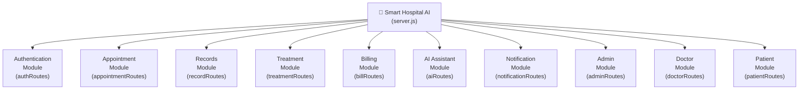
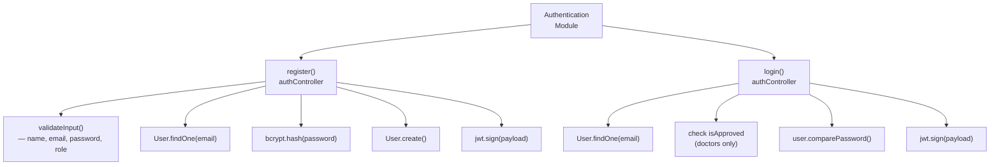
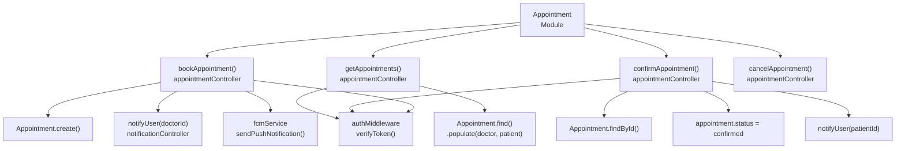
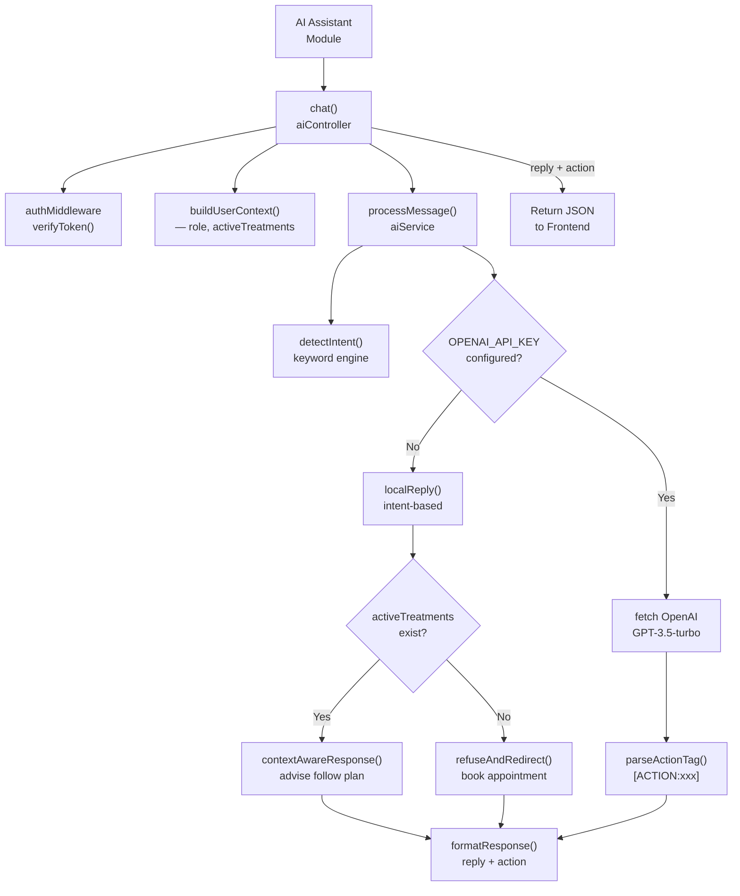
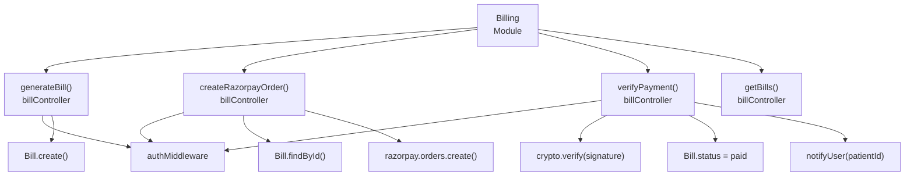
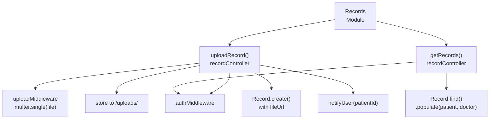
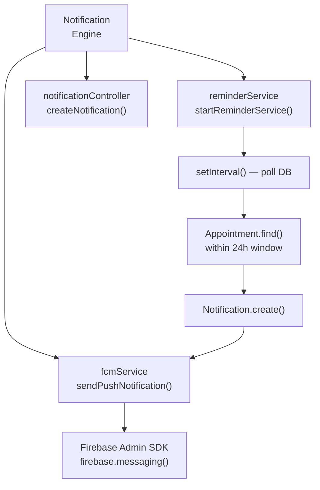

# Structure Chart Diagram — Smart Hospital AI

## Overview

A **Structure Chart** shows the hierarchical decomposition of the system into modules, depicting function calls (control flow) between them. Arrows indicate caller → callee relationships. Data couples (parameters passed) and flags are annotated where key.

---

## Top-Level Structure Chart

---

## Authentication Module Decomposition

---

## Appointment Module Decomposition

---

## AI Assistant Module Decomposition

---

## Billing Module Decomposition

---

## Records Module Decomposition

---

## Notification & Reminder Module Decomposition

