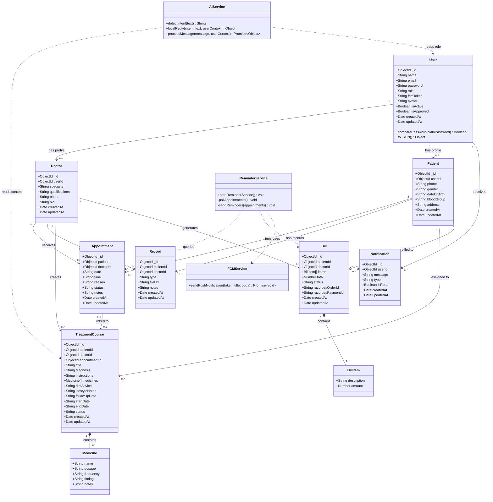

# Class Diagram — Smart Hospital AI

## Overview

Shows all **Mongoose models** (mapped as classes), their attributes, methods, and relationships (associations, references, composition).

---

## Full Class Diagram



---

## Relationship Summary

| Relationship | Type | Multiplicity |
|---|---|---|
| User → Doctor | Association (profile) | 1 to 0..1 |
| User → Patient | Association (profile) | 1 to 0..1 |
| Patient → Appointment | Association | 1 to 0..* |
| Doctor → Appointment | Association | 1 to 0..* |
| Patient → Record | Association | 1 to 0..* |
| Doctor → Record | Association | 1 to 0..* |
| Patient → TreatmentCourse | Association | 1 to 0..* |
| Doctor → TreatmentCourse | Association | 1 to 0..* |
| Appointment → TreatmentCourse | Association (optional link) | 0..1 to 0..1 |
| TreatmentCourse → Medicine | **Composition** (embedded) | 1 to 0..* |
| Patient → Bill | Association | 1 to 0..* |
| Doctor → Bill | Association | 1 to 0..* |
| Bill → BillItem | **Composition** (embedded) | 1 to 1..* |
| User → Notification | Association | 1 to 0..* |
| ReminderService → FCMService | **Dependency** | — |
| AIService → TreatmentCourse | **Dependency** (read context) | — |

---

## Attribute Enumerations

### `User.role`
```
admin | doctor | patient
```

### `Appointment.status`
```
pending | confirmed | cancelled | completed
```

### `TreatmentCourse.status`
```
active | completed | cancelled
```

### `Bill.status`
```
pending | paid | cancelled
```

### `Record.type`
```
xray | prescription | ecg | lab | other
```

### `Notification.type`
```
appointment | record | treatment | billing | system
```
