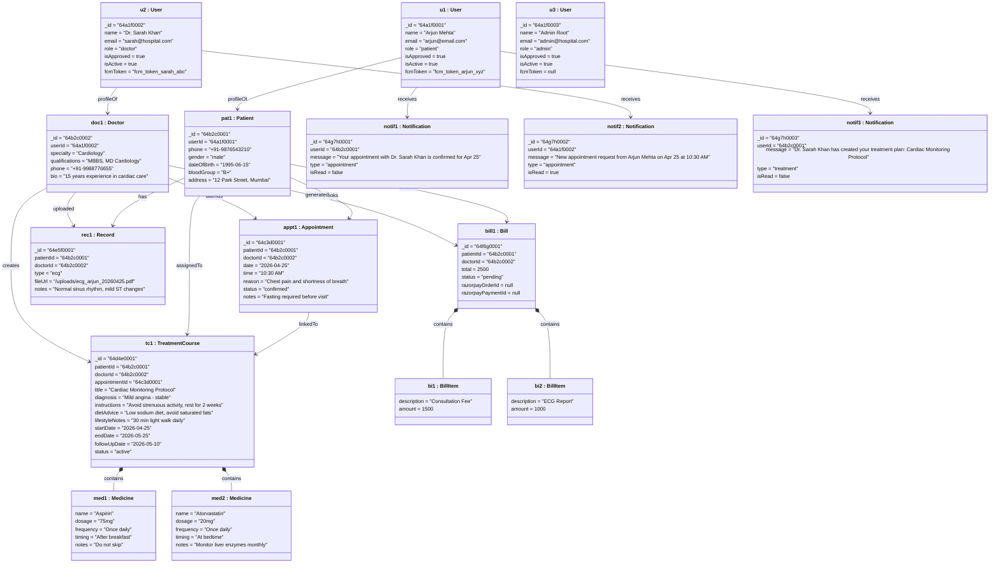

# Object Diagram — Smart Hospital AI

## Overview

An **Object Diagram** is a snapshot of the system at a specific point in time, showing **concrete instances** of classes with real example values. This represents a typical scenario: *Dr. Sarah confirms a patient appointment, an active treatment course exists, and an unpaid bill is pending.*

---

## Scenario: Patient Consults Doctor — Runtime Snapshot

---

## Instance State Summary

| Object | Class | Key State |
|---|---|---|
| `u1` | User | Patient — approved, active |
| `u2` | User | Doctor (Cardiologist) — approved, active |
| `u3` | User | Admin — approved, active |
| `pat1` | Patient | Arjun Mehta, B+ blood group |
| `doc1` | Doctor | Dr. Sarah Khan, Cardiology |
| `appt1` | Appointment | Confirmed for 25 Apr 2026, 10:30 AM |
| `tc1` | TreatmentCourse | Active — Cardiac Monitoring Protocol |
| `med1` | Medicine | Aspirin 75mg, once daily |
| `med2` | Medicine | Atorvastatin 20mg, at bedtime |
| `rec1` | Record | ECG uploaded as PDF |
| `bill1` | Bill | ₹2500 pending payment |
| `bi1` | BillItem | Consultation Fee — ₹1500 |
| `bi2` | BillItem | ECG Report — ₹1000 |
| `notif1` | Notification | Appointment confirmed (unread) |
| `notif2` | Notification | Appointment request (read by doctor) |
| `notif3` | Notification | Treatment plan created (unread) |

---

> [!NOTE]
> All `ObjectId` values are illustrative hex strings for documentation purposes. In MongoDB, these are 24-character BSON ObjectIds (e.g., `64a1f000000000000000001`).
