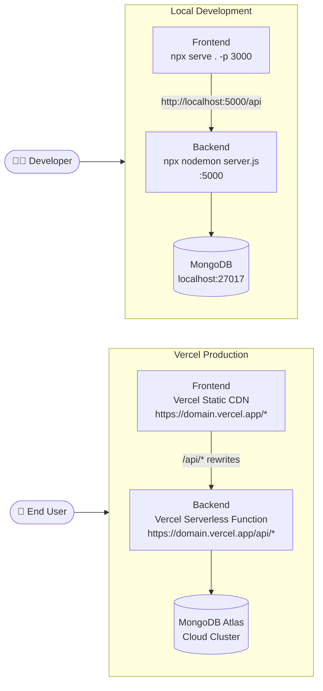
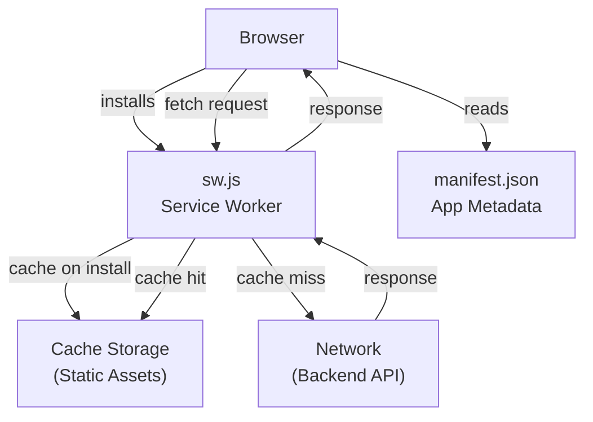

# Component Diagram — Smart Hospital AI

## Overview

A **Component Diagram** shows the physical/logical architecture of the system — how it is broken into deployable components and how those components communicate through defined interfaces.

---

## Top-Level Component Architecture

```mermaid
flowchart TB
    %% ── External Actors ───────────────────────────────────
    Browser(["🌐 Browser\n(Patient / Doctor / Admin)"])
    Mobile(["📱 Mobile Device\n(PWA)"])

    %% ── CDN / Static Hosting ──────────────────────────────
    subgraph VERCEL_STATIC ["Vercel Static Layer"]
        LANDING["index.html\nLanding Page"]
        PAGES["pages/\nHTML Pages"]
        SW["sw.js\nService Worker"]
        MANIFEST["manifest.json\nPWA Manifest"]
        CSS["assets/css/style.css"]
        JS_MODS["assets/js/\nJS Modules"]
    end

    %% ── Frontend Component Groups ──────────────────────────
    subgraph FRONTEND ["Frontend Components (Browser Runtime)"]
        API_CLIENT["api.js\nHTTP Client"]
        AUTH_MOD["auth.js\nAuth Module"]
        DASH_MOD["dashboard.js\nDashboard Module"]
        APPT_MOD["appointments.js\nAppointment Module"]
        REC_MOD["records.js\nRecords Module"]
        BILL_MOD["billing.js\nBilling Module"]
        AI_MOD["ai.js\nAI Chat Module"]
        PAT_MOD["patients.js\nPatients Module"]
        DOC_MOD["doctors.js\nDoctors Module"]
        UI_MOD["ui.js\nUI Utilities"]
    end

    %% ── Backend API Server ────────────────────────────────
    subgraph VERCEL_NODE ["Vercel Serverless / Local Node"]
        subgraph BACKEND ["Backend — Express Server (server.js)"]

            subgraph MIDDLEWARE ["Middleware Layer"]
                AUTH_MW["authMiddleware.js\nJWT Verification"]
                UPLOAD_MW["uploadMiddleware.js\nMulter File Upload"]
            end

            subgraph ROUTES ["Route Layer"]
                R_AUTH["authRoutes\n/api/auth"]
                R_DOC["doctorRoutes\n/api/doctors"]
                R_PAT["patientRoutes\n/api/patients"]
                R_APPT["appointmentRoutes\n/api/appointments"]
                R_REC["recordRoutes\n/api/records"]
                R_BILL["billRoutes\n/api/bills"]
                R_AI["aiRoutes\n/api/ai"]
                R_NOTIF["notificationRoutes\n/api/notifications"]
                R_ADMIN["adminRoutes\n/api/admin"]
                R_TREAT["treatmentRoutes\n/api/treatments"]
            end

            subgraph CONTROLLERS ["Controller Layer"]
                C_AUTH["authController"]
                C_DOC["doctorController"]
                C_PAT["patientController"]
                C_APPT["appointmentController"]
                C_REC["recordController"]
                C_BILL["billController"]
                C_AI["aiController"]
                C_NOTIF["notificationController"]
                C_ADMIN["adminController"]
                C_TREAT["treatmentController"]
            end

            subgraph SERVICES ["Service Layer"]
                AI_SVC["aiService.js\nOpenAI + Keyword Engine"]
                REMIND_SVC["reminderService.js\nBackground Polling"]
                FCM_SVC["fcmService.js\nPush Notification Sender"]
            end

            subgraph MODELS ["Data Models (Mongoose)"]
                M_USER["User Model"]
                M_DOC["Doctor Model"]
                M_PAT["Patient Model"]
                M_APPT["Appointment Model"]
                M_REC["Record Model"]
                M_BILL["Bill Model"]
                M_NOTIF["Notification Model"]
                M_TREAT["TreatmentCourse Model"]
            end

            UTILS["responseHelper.js\nUtils"]
        end
    end

    %% ── Data Store ────────────────────────────────────────
    subgraph DATA ["Data Layer"]
        MONGO[("🗄️ MongoDB\nsmarthospital DB")]
        UPLOADS["📁 /uploads/\nFile Storage"]
    end

    %% ── External Services ─────────────────────────────────
    subgraph EXTERNAL ["External Services"]
        OPENAI["🤖 OpenAI API\nGPT-3.5-turbo"]
        DEEPGRAM["🎙️ Deepgram API\nSpeech-to-Text"]
        RAZORPAY["💳 Razorpay\nPayment Gateway"]
        FIREBASE["🔔 Firebase FCM\nPush Notifications"]
    end

    %% ── Browser → Static Layer ────────────────────────────
    Browser --> LANDING
    Browser --> PAGES
    Mobile  --> SW
    Mobile  --> MANIFEST
    PAGES   --> CSS
    PAGES   --> JS_MODS

    %% ── JS Modules load into Browser Runtime ──────────────
    JS_MODS --> API_CLIENT
    JS_MODS --> AUTH_MOD
    JS_MODS --> DASH_MOD
    JS_MODS --> APPT_MOD
    JS_MODS --> REC_MOD
    JS_MODS --> BILL_MOD
    JS_MODS --> AI_MOD
    JS_MODS --> PAT_MOD
    JS_MODS --> DOC_MOD
    JS_MODS --> UI_MOD

    %% ── Frontend → Backend HTTP ───────────────────────────
    API_CLIENT -- "REST HTTP/HTTPS\n+ Bearer JWT" --> R_AUTH
    API_CLIENT -- "REST HTTP/HTTPS\n+ Bearer JWT" --> R_APPT
    API_CLIENT -- "REST HTTP/HTTPS\n+ Bearer JWT" --> R_REC
    API_CLIENT -- "REST HTTP/HTTPS\n+ Bearer JWT" --> R_BILL
    API_CLIENT -- "REST HTTP/HTTPS\n+ Bearer JWT" --> R_AI
    API_CLIENT -- "REST HTTP/HTTPS\n+ Bearer JWT" --> R_NOTIF
    API_CLIENT -- "REST HTTP/HTTPS\n+ Bearer JWT" --> R_TREAT
    API_CLIENT -- "REST HTTP/HTTPS\n+ Bearer JWT" --> R_DOC
    API_CLIENT -- "REST HTTP/HTTPS\n+ Bearer JWT" --> R_PAT
    API_CLIENT -- "REST HTTP/HTTPS\n+ Bearer JWT" --> R_ADMIN

    %% ── Routes → Middleware → Controllers ─────────────────
    R_AUTH  --> AUTH_MW --> C_AUTH
    R_DOC   --> AUTH_MW --> C_DOC
    R_PAT   --> AUTH_MW --> C_PAT
    R_APPT  --> AUTH_MW --> C_APPT
    R_REC   --> AUTH_MW --> UPLOAD_MW --> C_REC
    R_BILL  --> AUTH_MW --> C_BILL
    R_AI    --> AUTH_MW --> C_AI
    R_NOTIF --> AUTH_MW --> C_NOTIF
    R_ADMIN --> AUTH_MW --> C_ADMIN
    R_TREAT --> AUTH_MW --> C_TREAT

    %% ── Controllers → Services ────────────────────────────
    C_AI   --> AI_SVC
    C_APPT --> FCM_SVC
    C_NOTIF --> FCM_SVC
    REMIND_SVC --> FCM_SVC

    %% ── Controllers → Models ──────────────────────────────
    C_AUTH  --> M_USER
    C_DOC   --> M_DOC
    C_PAT   --> M_PAT
    C_APPT  --> M_APPT
    C_REC   --> M_REC
    C_BILL  --> M_BILL
    C_NOTIF --> M_NOTIF
    C_TREAT --> M_TREAT
    C_ADMIN --> M_USER

    %% ── Models → MongoDB ──────────────────────────────────
    M_USER  --> MONGO
    M_DOC   --> MONGO
    M_PAT   --> MONGO
    M_APPT  --> MONGO
    M_REC   --> MONGO
    M_BILL  --> MONGO
    M_NOTIF --> MONGO
    M_TREAT --> MONGO

    %% ── File Storage ──────────────────────────────────────
    UPLOAD_MW --> UPLOADS
    C_REC     --> UPLOADS

    %% ── External Service Calls ────────────────────────────
    AI_SVC      -- "POST /v1/chat/completions" --> OPENAI
    AI_MOD      -- "WebSocket / REST"          --> DEEPGRAM
    C_BILL      -- "orders.create()"           --> RAZORPAY
    FCM_SVC     -- "firebase.messaging()"      --> FIREBASE
    FIREBASE    -- "push notification"         --> Browser
    FIREBASE    -- "push notification"         --> Mobile
```

---

## Component Interface Summary

| Component | Interface (Port) | Protocol |
|---|---|---|
| Frontend ↔ Backend | REST API | HTTP/HTTPS + JSON |
| Frontend auth | JWT in `Authorization: Bearer` header | HTTP Header |
| File Upload | `multipart/form-data` | HTTP POST |
| AI Service ↔ OpenAI | `POST /v1/chat/completions` | HTTPS + JSON |
| Voice ↔ Deepgram | WebSocket stream / REST | WSS / HTTPS |
| Billing ↔ Razorpay | Razorpay Node SDK | HTTPS |
| Notifications ↔ FCM | Firebase Admin SDK | HTTPS/gRPC |
| Models ↔ MongoDB | Mongoose ODM | TCP (MongoDB wire protocol) |
| PWA ↔ Browser | Service Worker + Cache API | Browser API |

---

## Deployment View

---

## PWA Component Detail

